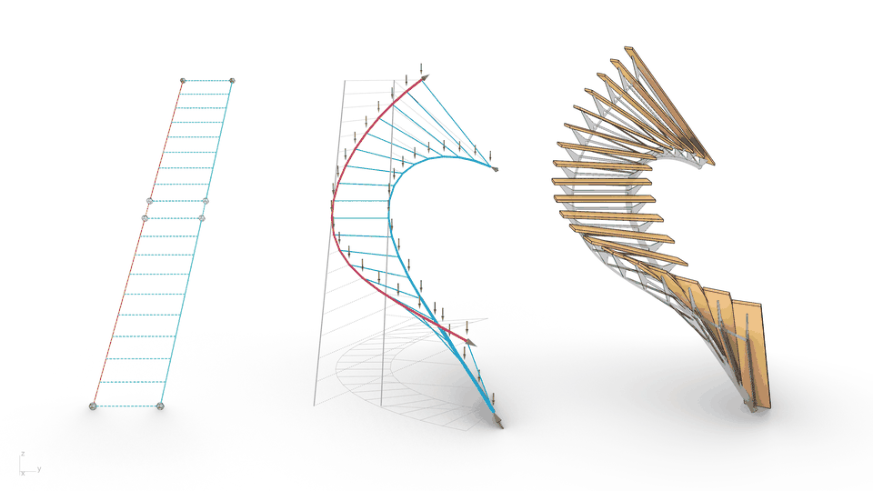

# COMPAS CEM

[](https://github.com/arpastrana/compas_cem/actions/workflows/build.yml)
[](https://github.com/arpastrana/compas_cem/blob/main/LICENSE)
[](https://pypi.org/project/compas-cem/)
[](https://pypi.org/project/compas-cem/)
[](https://compas.dev/mission-control/#compas_cem)
[](https://doi.org/10.1016/j.cad.2022.103435)
[](https://arxiv.org/abs/2111.02607)
[](https://doi.org/10.5281/zenodo.5705740)



The [Combinatorial Equilibrium Modeling (CEM)](https://doi.org/10.1016/j.cad.2022.103435) framework for [COMPAS](https://compas.dev/).

The [CEM framework](https://doi.org/10.1016/j.cad.2022.103435) is a numerical form-finding approach to generate forms in static equilibrium for spatial bar structures subjected to combinations of tension-compression forces and design goals.
**COMPAS CEM** encapsulates the [CEM framework](https://doi.org/10.1016/j.cad.2022.103435) into an open-source structural design tool that enables the formulation and the solution of constrained form-finding problems in plain and simple [Python](https://www.python.org/) code.

## Main features

- **Mix tension and compression forces:** Explore a wider spectrum of structural typologies by combining internal tension and compression forces in the same structure. Design space frames, bridges, tensegrities, and staircases and go beyond the conventional catalog of compression-only shells and cable-nets!

- **Solve constrained form-finding problems efficiently via automatic differentiation:** Generate forms in static equilibrium that simultaneously meet a priori design goals such as best-fitting a global target shape, restraining bar lengths, and controlling the reaction forces at the supports of a structure.

- **Usable across different 3D modeling software and operating systems:** COMPAS CEM runs on Windows, MacOS and Linux (perhaps one day in the [metaverse](https://apnews.com/article/meta-facebook-explaining-the-metaverse-f57e01cd5739840945e89fd668b0fa27)) and it does not depend on any CAD software to work. However, it provides the necessary interfaces to be seamlessly used inside popular design environments like [Rhino](https://www.rhino3d.com/), [Blender](https://www.blender.org/), and [Grasshopper](https://grasshopper3d.com/). As a [COMPAS](https://compas.dev/) extension, COMPAS CEM offers native integration and data exchange with other extensions and plugins in the COMPAS ecosystem.

- **Move those sliders with the Grasshopper plugin:** Are you a [Grasshopper](https://grasshopper3d.com/) person? Worry not. COMPAS CEM is also shipped as a precooked Grasshopper plugin to readily integrate our constrained form-finding engine into your next spaghetti pipeline 🍝.

## Installation

Install **COMPAS CEM** with a one-liner via `pip`:

```bash
pip install compas-cem
```

Alternatively, add it to a [uv](https://docs.astral.sh/uv/) project:

```bash
uv add compas-cem
```

Either pulls in COMPAS 2.x and the other core dependencies automatically.
**COMPAS CEM** supports Python 3.9 to 3.13.
To draw diagrams with the plotter or the viewer, as the examples do, install the `viz` extra instead, for example `pip install "compas-cem[viz]"`.
For other ways to install and the `uv sync` development setup, see the [installation guide](https://arpastrana.github.io/compas_cem/latest/installation/).

### Grasshopper plugin

The [Grasshopper](https://grasshopper3d.com/) plugin runs in Rhino 8.
Install it from Rhino's Package Manager: search for `compas_cem`, install it and restart Rhino.
The first component you run installs the `compas-cem` Python package into Rhino.

## First steps

- [COMPAS CEM Docs](https://arpastrana.github.io/compas_cem/)
- [COMPAS CEM Examples](https://arpastrana.github.io/compas_cem/latest/examples/)
- [COMPAS CEM API Reference](https://arpastrana.github.io/compas_cem/latest/api/compas_cem/)
- [COMPAS User Guide](https://compas.dev/compas/latest/userguide/index.html)
- [COMPAS API Reference](https://compas.dev/compas/latest/api/index.html)

## Are you a bug hunter?

If you find a bug or want to suggest a potential enhancement,
please help us tackle it by filing a [report](https://github.com/arpastrana/compas_cem/issues).

## Questions and feedback

We encourage the use of the [COMPAS framework forum](https://forum.compas-framework.org/) for questions and discussions.

## Contributing

Pull requests are warmly welcome! Check the [Contributor's Guide](https://github.com/arpastrana/compas_cem/blob/main/CONTRIBUTING.md)
for more details.

## Citing

If you use **COMPAS CEM** for a project or research, please cite us using these [references](https://arpastrana.github.io/compas_cem/latest/citing/).

## Acknowledgements

This work has been supported in part by the U.S. National Science Foundation under grant OAC-2118201 and the [NSF Institute for Data Driven Dynamical Design](https://www.mines.edu/id4).

## License

MIT
